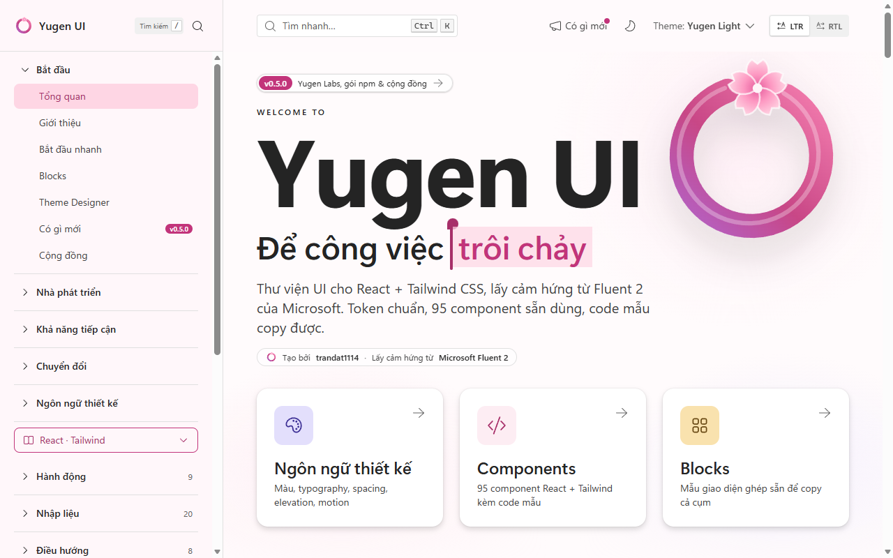
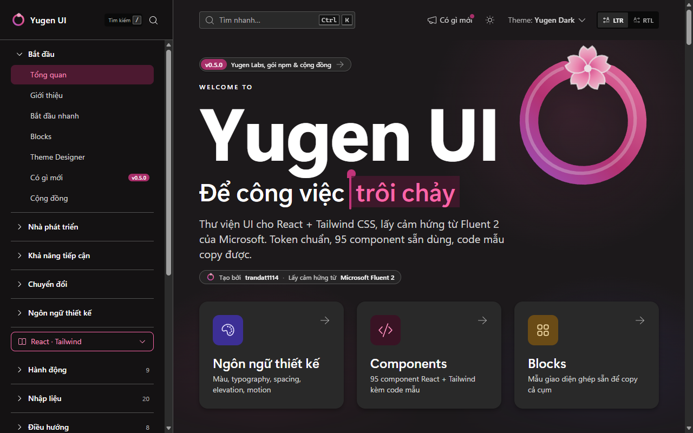
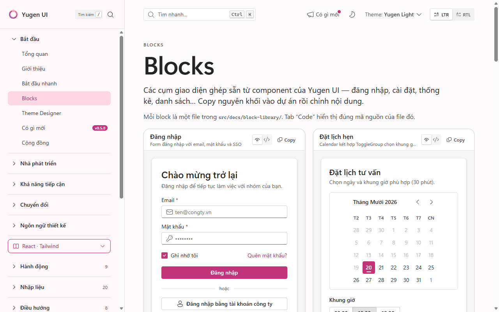
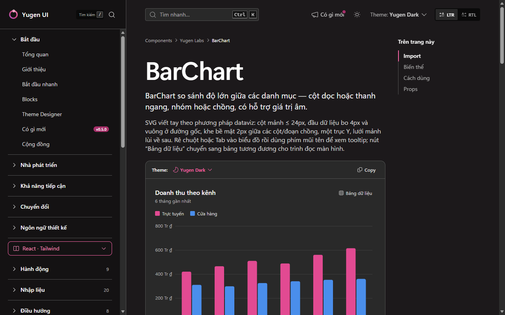
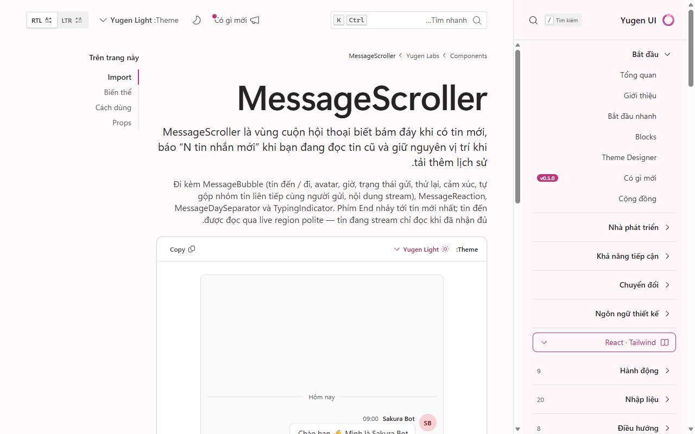
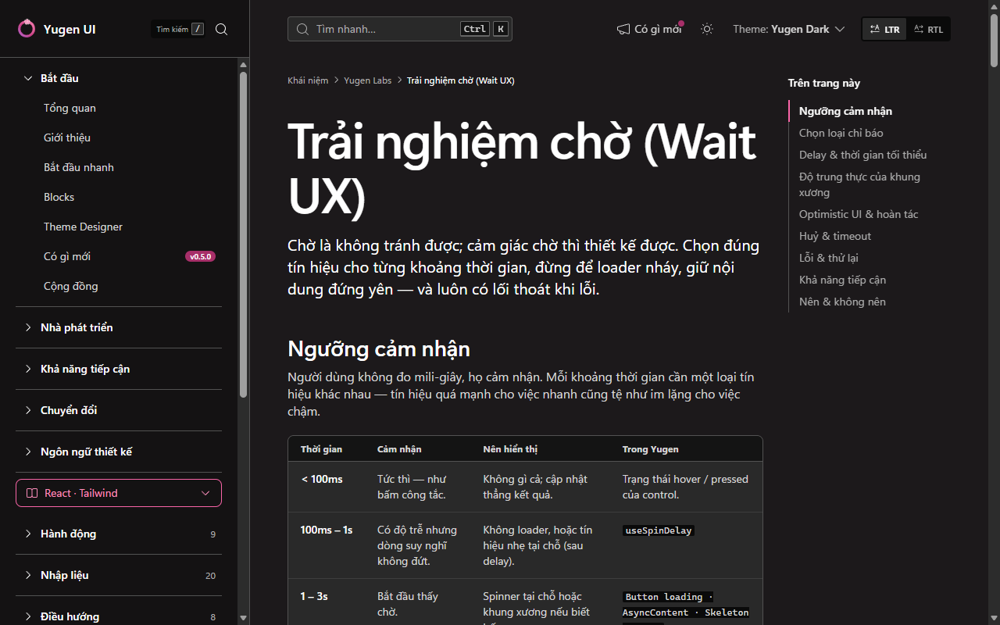

# Yugen UI 幽玄

**Yugen UI** is a React component library and design system for **Tailwind CSS v4**. It combines
[Microsoft Fluent 2](https://fluent2.microsoft.design/)-inspired design tokens and component behaviour with the
copy-friendly, composable API style of [shadcn/ui](https://ui.shadcn.com/), and ships with its own **Sakura 桜**
(cherry-blossom) brand.

- **Fluent 2-style tokens** — colour, spacing, type ramp, radius, elevation and motion tokens with the same names
  as Fluent UI React v9 (`colorNeutralForeground1`, `spacingHorizontalM`, `shadow16`, `durationNormal`…), exposed as
  short Tailwind utilities (`text-foreground-1`, `p-M`, `shadow-16`, `duration-normal`).
- **Accessible components** built on Radix UI primitives, `cmdk` and `react-day-picker`, with full keyboard support.
- **Themes**: light, dark and Windows-style **high contrast**; brands **Sakura**, **Web** (Fluent blue),
  **Teams** — or your own, generated with the Theme Designer.
- **RTL** out of the box (logical properties, Radix `DirectionProvider`).
- **Tree-shakeable ESM**, TypeScript types, `"use client"` directives for the Next.js App Router.
- Icons from [Fluent System Icons](https://github.com/microsoft/fluentui-system-icons) (`@fluentui/react-icons`).

**Documentation:** <https://trandat1114.github.io/Yugen-UI/> — every component with live examples, copyable code,
blocks, concepts and a Theme Designer (Vietnamese; English docs are on the [roadmap](./ROADMAP.md)).

| Light | Dark |
|---|---|
|  |  |
|  |  |
|  |  |

> Yugen UI is an independent project. It is **not affiliated with or endorsed by Microsoft**.

---

## Contents

- [Install](#install)
- [Setup A — with Tailwind CSS v4](#setup-a--with-tailwind-css-v4-recommended)
- [Setup B — without Tailwind](#setup-b--without-tailwind)
- [YugenProvider](#yugenprovider)
- [Usage](#usage)
- [Theming](#theming)
- [RTL](#rtl)
- [Copy-paste mode](#copy-paste-mode)
- [Next.js](#nextjs-app-router)
- [Package contents](#package-contents)
- [Browser support](#browser-support)
- [Contributing](#contributing)
- [Credits](#credits) · [License](#license)
- [Tiếng Việt](#tiếng-việt)

## Install

```bash
npm install yugen-ui
# pnpm add yugen-ui · yarn add yugen-ui · bun add yugen-ui
```

Peer dependencies: `react` and `react-dom` **>= 18**. `tailwindcss` **v4** is an optional peer (only needed for
Setup A).

## Setup A — with Tailwind CSS v4 (recommended)

In your main stylesheet (e.g. `src/index.css`, or `app/globals.css` in Next.js):

```css
@import "tailwindcss";
@import "yugen-ui/theme.css";
```

`theme.css` contains the tokens, the `@theme` bridge, the custom `@utility` rules, keyframes and base styles. It also
registers `@source "./components"`, so Tailwind automatically scans the package's compiled components — no extra
configuration is needed. If your setup does not pick it up, add the path yourself, relative to **your** CSS file:

```css
@source "../node_modules/yugen-ui/dist"; /* src/index.css or app/globals.css */
/* src/app/globals.css → "../../node_modules/yugen-ui/dist" */
```

> **Heads-up:** like the library itself, `theme.css` turns off Tailwind's default colour, radius, shadow, font-size
> and easing scales (`--color-*: initial`…), so `bg-blue-500`, `rounded-lg`, `shadow-md` or `text-sm` no longer
> exist in your app. Use the Yugen utilities instead: `bg-background-1`, `text-foreground-2`, `p-M`, `gap-S`,
> `text-body1`, `rounded-medium`, `shadow-4`. Spacing tokens use **upper-case** Fluent suffixes
> (`XXS XS SNudge S MNudge M L XL XXL XXXL`); the numeric Tailwind spacing scale (`p-2`, `h-8`) still works.

## Setup B — without Tailwind

Import the precompiled stylesheet once, at the root of your app:

```ts
import "yugen-ui/styles.css";
```

`styles.css` (about 110 kB, ~18 kB gzipped) contains Tailwind's preflight (a modern CSS reset), all tokens and every
utility used by the components. Utilities live in `@layer utilities`, so your own unlayered CSS always wins. Only
the classes used by Yugen components are included — utility classes you write yourself are not generated without
Tailwind.

Need only the CSS variables (e.g. to use `var(--colorBrandBackground)` in your own CSS)? Import
`yugen-ui/tokens.css`. Both `theme.css` and `styles.css` already include the tokens.

## YugenProvider

Wrap your app once. The root provider writes `data-theme`, `data-brand` and `dir` on `<html>` so portalled surfaces
(Dialog, Menu, Popover, Tooltip, Toast) get the same theme.

```tsx
import { YugenProvider } from "yugen-ui";

export function Root() {
  return (
    <YugenProvider applyToDocument withToaster theme="light" brand="sakura" dir="ltr">
      <App />
    </YugenProvider>
  );
}
```

| Prop | Type | Default | Description |
|---|---|---|---|
| `theme` | `"light" \| "dark" \| "high-contrast"` | `"light"` | Colour theme. |
| `brand` | `"sakura" \| "web" \| "teams" \| string` | `"sakura"` | Brand ramp (`data-brand`). |
| `dir` | `"ltr" \| "rtl"` | `"ltr"` | Text direction (includes Radix `DirectionProvider`). |
| `applyToDocument` | `boolean` | `false` | Apply theme/brand/dir to `<html>` — use on the root provider. |
| `withToaster` | `boolean` | `false` | Mount a `<Toaster />` so `toast()` works. |
| `withTooltipProvider` | `boolean` | `true` | Mount Radix `TooltipProvider`. |

Nested providers (without `applyToDocument`) scope a theme to a subtree. Read the current values with `useYugen()`.

## Usage

```tsx
import { Button, Card, CardContent, CardFooter, CardHeader, Field, Input, toast } from "yugen-ui";

export function SignupCard() {
  return (
    <Card>
      <CardHeader header="Create account" description="It only takes a minute." />
      <CardContent>
        <Field label="Email" hint="We never share it." required>
          <Input type="email" placeholder="you@example.com" />
        </Field>
      </CardContent>
      <CardFooter>
        <Button appearance="primary" onClick={() => toast({ intent: "success", title: "Welcome!" })}>
          Sign up
        </Button>
      </CardFooter>
    </Card>
  );
}
```

Merge classes with `cn()` (exported from the package). It is `clsx` + a `tailwind-merge` instance that knows the
Yugen scales — plain `twMerge` would drop classes such as `text-body1`.

```tsx
import { cn } from "yugen-ui";
<div className={cn("p-M text-body1", isActive && "bg-brand-background-2")} />;
```

## Theming

Themes and brands are plain CSS custom properties switched by attributes — there is no `dark:` variant.

```html
<html data-theme="dark" data-brand="web" dir="ltr">
```

- `data-theme`: `light` · `dark` · `high-contrast` (black background, cyan accent, yellow links; every shadow
  becomes a 1px outline).
- `data-brand`: `sakura` (default) · `web` · `teams` · any custom name.
- Attributes can be nested: put `data-theme` / `data-brand` on any element to re-theme its subtree (or use a nested
  `<YugenProvider>`).

**Custom brand.** The docs site has a **Theme Designer** page (`npm run dev` → `#/theme-designer`) that builds a
16-step brand ramp from one key colour and checks contrast. The same algorithm is exported:

```ts
import { generateBrandRamp, adjustKeyForContrast, rampToCss, rampToStyle } from "yugen-ui";

const ramp = generateBrandRamp(adjustKeyForContrast("#0f766e"));
rampToCss("ocean", ramp); // → '[data-brand="ocean"] { --brand-10: …; … --brand-160: …; }' — paste into your CSS
rampToStyle(ramp);        // → { "--brand-10": "…", … } — inline style for a scoped element
```

Then use `<YugenProvider brand="ocean">` (or `data-brand="ocean"`).

## RTL

Set `dir="rtl"` on `YugenProvider` (or on `<html>`). Components only use logical properties
(`ms/me/ps/pe/start/end`), directional icons flip automatically, keyboard navigation follows the direction and
slide animations reverse via the `--yugen-dir` variable. Known limitation: horizontal `Resizable` groups keep an LTR
layout because `react-resizable-panels` measures the physical X axis.

## Copy-paste mode

Prefer owning the code, shadcn-style? Use the **shadcn CLI** — Yugen UI publishes a compatible registry. `init` runs once
per project: it creates `components.json` if missing, copies the theme, `cn()` and `YugenProvider`, installs npm packages
and adds the theme `@import` to your CSS. `add` then copies components and the components they import:

```bash
npx shadcn@latest init https://trandat1114.github.io/Yugen-UI/r/init.json   # Next.js: …/r/init-next.json
npx shadcn@latest add https://trandat1114.github.io/Yugen-UI/r/button.json
# everything: …/r/all.json · catalogue: …/r/registry.json
```

With a namespaced registry in
`components.json` — `"registries": { "@yugen": "https://trandat1114.github.io/Yugen-UI/r/{name}.json" }` — you can run
`npx shadcn@latest add @yugen/button @yugen/chart`. Each component page in the docs shows its exact command.

Or copy by hand from this repository:

1. `src/components/ui/<Name>/` — plus any sibling components it imports (e.g. `Combobox` uses `Popover` and `Field`).
2. `src/lib/cn.ts`.
3. The styles: `src/styles/tokens.css` and the theme part of `src/index.css` (`@theme`, `@utility`, keyframes, base),
   or simply `@import "yugen-ui/theme.css"`.
4. Configure the `@/` path alias (`"paths": { "@/*": ["./src/*"] }` + your bundler alias) and install the
   component's dependencies (Radix packages, `class-variance-authority`, `@fluentui/react-icons`…).
5. Next.js App Router: add `"use client";` at the top of every copied component file.

## Starter templates

One command downloads a template, installs dependencies and starts the dev server — preview them all at
[#/templates](https://trandat1114.github.io/Yugen-UI/#/templates), or open one on StackBlitz with nothing to install.

```bash
npx giget@latest gh:trandat1114/Yugen-UI/templates/vite-starter my-app --install && cd my-app && npm run dev
```

| Template | What you get |
| --- | --- |
| `vite-starter` | Blank start: persisted theme, toast, `@/` alias, SEO basics, a cherry-blossom welcome page to delete |
| `vite-saas` | 8-page SaaS app: sidebar → drawer, Ctrl K palette, notifications, themes & brands |
| `vite-blog` | Markdown blog: tags, search, TOC; build-time HTML per post, sitemap.xml, rss.xml |
| `vite-dashboard` | KPI tiles, charts, recent transactions |
| `vite-ai-chat` | AI assistant chat with agent trace |

Prefer the shadcn CLI? `npx shadcn@latest init https://trandat1114.github.io/Yugen-UI/r/init.json` sets up the theme,
`cn()` and `YugenProvider` in one step.

## Next.js (App Router)

The published build already starts every component module with `"use client";`. The entry barrel, `cn()` and
the brand-ramp helpers carry **no** directive, so you can import components from Server Components and call `cn()`
on the server.

- Setup A with Next.js uses `@tailwindcss/postcss`; put the two `@import` lines in `app/globals.css`.
- To avoid a theme flash on first paint, render the attributes on `<html>` in `app/layout.tsx`:
  `<html lang="en" data-theme="light" data-brand="sakura" dir="ltr" suppressHydrationWarning>`.
- Compound components (e.g. `Card` + `CardHeader`) are separate named exports, so they work from Server Components
  as long as you pass serialisable props.

## Package contents

| Import | Contents |
|---|---|
| `yugen-ui` | Components, hooks, `cn`, brand-ramp helpers — ESM (`preserveModules`, tree-shakeable) + `.d.ts` |
| `yugen-ui/theme.css` | Tailwind v4 theme source (Setup A) |
| `yugen-ui/styles.css` | Precompiled stylesheet (Setup B) |
| `yugen-ui/tokens.css` | Raw design tokens (CSS custom properties only) |

The package is ESM-only (`"type": "module"`), which every modern bundler and Next.js support.

## Browser support

The last two versions of Chrome / Edge (**111+**), Firefox (**128+**) and Safari on macOS / iOS (**16.4+**) — the
same baseline as Tailwind CSS v4 (cascade layers, `@property`, `color-mix()`).

## Contributing

Contributions are welcome — please read [CONTRIBUTING.md](./CONTRIBUTING.md) and the project rulebook
[Design.md](./Design.md), and follow the [Code of Conduct](./CODE_OF_CONDUCT.md). Security issues: see
[SECURITY.md](./SECURITY.md).

```bash
npm install
npm run dev          # docs site at http://localhost:5173
npm run typecheck
npm run lint:classes # Tailwind canonical-class check (add --fix to repair)
npm run build:lib    # library → dist/   (npm run build:docs → dist-docs/)
```

### For maintainers

- Before the first public release, add `repository`, `homepage` and `bugs` to `package.json` once the GitHub
  repository URL is final — `npm publish --provenance` (used by `.github/workflows/release.yml`) requires
  `repository.url` to match the repository that runs the workflow. Also add the docs URL to this README.
- Release: bump `version`, update `CHANGELOG.md`, tag `vX.Y.Z` and push the tag (the workflow needs an
  `NPM_TOKEN` secret). `prepublishOnly` runs typecheck, the class lint and `build:lib`.

## Credits

Inspired by [Microsoft Fluent 2](https://fluent2.microsoft.design/) and [shadcn/ui](https://ui.shadcn.com/).
Not affiliated with or endorsed by Microsoft. Icons: [Fluent System Icons](https://github.com/microsoft/fluentui-system-icons) (MIT).
Behaviour primitives: [Radix UI](https://www.radix-ui.com/), [cmdk](https://cmdk.paco.me/),
[React DayPicker](https://daypicker.dev/), [react-resizable-panels](https://github.com/bvaughn/react-resizable-panels).

## License

[MIT](./LICENSE) © 2026 [trandat1114](https://github.com/trandat1114)

---

## Tiếng Việt

**Yugen UI** là thư viện component React và design system cho **Tailwind CSS v4**. Dự án kết hợp token và hành vi
component lấy cảm hứng từ [Microsoft Fluent 2](https://fluent2.microsoft.design/) với phong cách API dễ sao chép,
dễ ghép của [shadcn/ui](https://ui.shadcn.com/), cùng brand riêng **Sakura 桜** (hoa anh đào).

- **Token kiểu Fluent 2** — màu, spacing, type ramp, bo góc, elevation, motion trùng tên với Fluent UI React v9
  (`colorNeutralForeground1`, `spacingHorizontalM`, `shadow16`, `durationNormal`…), dùng qua utility Tailwind ngắn
  gọn (`text-foreground-1`, `p-M`, `shadow-16`, `duration-normal`).
- **Component có khả năng tiếp cận** dựa trên Radix UI, `cmdk`, `react-day-picker`, hỗ trợ bàn phím đầy đủ.
- **Theme**: sáng, tối và **tương phản cao**; brand **Sakura**, **Web** (xanh Fluent), **Teams** — hoặc brand tự tạo
  bằng Theme Designer.
- **RTL** sẵn có (thuộc tính logic, `DirectionProvider` của Radix).
- **ESM tree-shake được**, có kiểu TypeScript, chỉ thị `"use client"` cho Next.js App Router.
- Icon: [Fluent System Icons](https://github.com/microsoft/fluentui-system-icons) (`@fluentui/react-icons`).

**Tài liệu:** <https://trandat1114.github.io/Yugen-UI/> — mọi component kèm ví dụ chạy được, code copy được, block,
khái niệm và Theme Designer. Ảnh chụp màn hình ở [phần tiếng Anh](#yugen-ui-幽玄); lộ trình ở [ROADMAP.md](./ROADMAP.md).

> Yugen UI là dự án độc lập, **không liên kết và không được Microsoft bảo trợ**.

### Cài đặt

```bash
npm install yugen-ui
```

Peer dependency: `react`, `react-dom` **>= 18**. `tailwindcss` **v4** là peer tuỳ chọn (chỉ cần cho Cách A).

### Cách A — dùng cùng Tailwind CSS v4 (khuyên dùng)

Trong file CSS chính (vd. `src/index.css`, hoặc `app/globals.css` với Next.js):

```css
@import "tailwindcss";
@import "yugen-ui/theme.css";
```

`theme.css` gồm token, cầu nối `@theme`, các `@utility` tuỳ biến, keyframes và style nền. File này đã khai báo sẵn
`@source "./components"` nên Tailwind tự quét các component đã build của gói — không cần cấu hình thêm. Nếu môi
trường của bạn không nhận, tự thêm đường dẫn, **tương đối với file CSS của bạn**:

```css
@source "../node_modules/yugen-ui/dist"; /* src/index.css hoặc app/globals.css */
/* src/app/globals.css → "../../node_modules/yugen-ui/dist" */
```

> **Lưu ý:** giống thư viện, `theme.css` tắt các scale mặc định của Tailwind về màu, bo góc, bóng, cỡ chữ và easing
> (`--color-*: initial`…), nên `bg-blue-500`, `rounded-lg`, `shadow-md`, `text-sm` sẽ không còn trong ứng dụng của bạn.
> Dùng utility của Yugen: `bg-background-1`, `text-foreground-2`, `p-M`, `gap-S`, `text-body1`, `rounded-medium`,
> `shadow-4`. Spacing token dùng hậu tố Fluent **viết hoa** (`XXS XS SNudge S MNudge M L XL XXL XXXL`); thang số
> của Tailwind (`p-2`, `h-8`) vẫn dùng được.

### Cách B — không dùng Tailwind

Import stylesheet đã biên dịch một lần ở gốc ứng dụng:

```ts
import "yugen-ui/styles.css";
```

`styles.css` (khoảng 110 kB, ~18 kB gzip) gồm preflight của Tailwind (CSS reset hiện đại), toàn bộ token và mọi utility mà
component dùng. Utility nằm trong `@layer utilities` nên CSS không-layer của bạn luôn thắng. Chỉ có các class mà
component Yugen dùng — class utility bạn tự viết sẽ không được sinh ra khi không có Tailwind.

Chỉ cần biến CSS (vd. dùng `var(--colorBrandBackground)` trong CSS riêng)? Import `yugen-ui/tokens.css`.
`theme.css` và `styles.css` đều đã chứa token.

### YugenProvider

Bọc ứng dụng một lần. Provider gốc ghi `data-theme`, `data-brand`, `dir` lên `<html>` để các bề mặt render qua portal
(Dialog, Menu, Popover, Tooltip, Toast) cũng đúng theme.

```tsx
import { YugenProvider } from "yugen-ui";

export function Root() {
  return (
    <YugenProvider applyToDocument withToaster theme="light" brand="sakura" dir="ltr">
      <App />
    </YugenProvider>
  );
}
```

- `theme`: `"light" | "dark" | "high-contrast"` · `brand`: `"sakura" | "web" | "teams" | <tên brand tự tạo>` ·
  `dir`: `"ltr" | "rtl"`.
- `applyToDocument`: áp lên `<html>` (dùng cho provider gốc). `withToaster`: gắn `<Toaster />` để gọi `toast()`.
  `withTooltipProvider` (mặc định `true`): gắn `TooltipProvider` của Radix.
- Provider lồng (không có `applyToDocument`) chỉ đổi theme cho nhánh con. Đọc giá trị hiện tại bằng `useYugen()`.

### Sử dụng

```tsx
import { Button, Card, CardContent, CardFooter, CardHeader, Field, Input, toast } from "yugen-ui";

export function SignupCard() {
  return (
    <Card>
      <CardHeader header="Tạo tài khoản" description="Chỉ mất một phút." />
      <CardContent>
        <Field label="Email" hint="Chúng tôi không chia sẻ email của bạn." required>
          <Input type="email" placeholder="ban@example.com" />
        </Field>
      </CardContent>
      <CardFooter>
        <Button appearance="primary" onClick={() => toast({ intent: "success", title: "Chào mừng!" })}>
          Đăng ký
        </Button>
      </CardFooter>
    </Card>
  );
}
```

Gộp class bằng `cn()` (được export từ gói): `clsx` + `tailwind-merge` đã cấu hình scale của Yugen — `twMerge` gốc sẽ
xoá nhầm các class như `text-body1`.

### Theme

Theme và brand là biến CSS, đổi bằng attribute — không có variant `dark:`.

```html
<html data-theme="dark" data-brand="web" dir="ltr">
```

- `data-theme`: `light` · `dark` · `high-contrast` (nền đen, nhấn cyan, link vàng; mọi bóng đổ thành viền 1px).
- `data-brand`: `sakura` (mặc định) · `web` · `teams` · tên brand tự tạo.
- Có thể lồng: đặt `data-theme` / `data-brand` trên bất kỳ phần tử nào để đổi theme cho nhánh con (hoặc dùng
  `<YugenProvider>` lồng).

**Brand tự tạo.** Trang docs có **Theme Designer** (`npm run dev` → `#/theme-designer`) sinh ramp brand 16 bậc từ một
màu key và kiểm tra tương phản. Thuật toán được export sẵn:

```ts
import { generateBrandRamp, adjustKeyForContrast, rampToCss, rampToStyle } from "yugen-ui";

const ramp = generateBrandRamp(adjustKeyForContrast("#0f766e"));
rampToCss("ocean", ramp); // → '[data-brand="ocean"] { --brand-10: …; … }' — dán vào CSS của bạn
rampToStyle(ramp);        // → { "--brand-10": "…", … } — style inline cho một phần tử
```

Sau đó dùng `<YugenProvider brand="ocean">` (hoặc `data-brand="ocean"`).

### RTL

Đặt `dir="rtl"` trên `YugenProvider` (hoặc `<html>`). Component chỉ dùng thuộc tính logic (`ms/me/ps/pe/start/end`),
icon chỉ hướng tự lật, điều hướng bàn phím theo hướng chữ, animation trượt tự đảo chiều qua biến `--yugen-dir`.
Giới hạn đã biết: nhóm `Resizable` ngang giữ bố cục LTR vì `react-resizable-panels` đo theo trục X vật lý.

### Chế độ copy-paste

Muốn sở hữu mã nguồn như shadcn? Dùng **shadcn CLI** — Yugen UI có registry tương thích. `init` chạy một lần mỗi dự án:
tạo `components.json` nếu chưa có, chép theme, `cn()` và `YugenProvider`, cài gói npm và tự thêm `@import` theme vào CSS.
Sau đó `add` chép component cùng các component nó import:

```bash
npx shadcn@latest init https://trandat1114.github.io/Yugen-UI/r/init.json   # Next.js: …/r/init-next.json
npx shadcn@latest add https://trandat1114.github.io/Yugen-UI/r/button.json
# tất cả: …/r/all.json · danh mục: …/r/registry.json
```

Khai báo registry có tên trong
`components.json` — `"registries": { "@yugen": "https://trandat1114.github.io/Yugen-UI/r/{name}.json" }` — để gõ
`npx shadcn@latest add @yugen/button @yugen/chart`. Trang docs của mỗi component có sẵn lệnh cài.

Hoặc sao chép thủ công từ repo này:

1. `src/components/ui/<Name>/` — kèm các component anh em mà nó import (vd. `Combobox` dùng `Popover` và `Field`).
2. `src/lib/cn.ts`.
3. Style: `src/styles/tokens.css` và phần theme trong `src/index.css` (`@theme`, `@utility`, keyframes, base) — hoặc
   đơn giản `@import "yugen-ui/theme.css"`.
4. Cấu hình alias `@/` (`"paths": { "@/*": ["./src/*"] }` + alias của bundler) và cài dependency của component
   (các gói Radix, `class-variance-authority`, `@fluentui/react-icons`…).
5. Next.js App Router: thêm `"use client";` ở đầu mỗi file component đã chép.

### Starter template

Một lệnh tải template, cài phụ thuộc và chạy dev server — xem trước ở
[#/templates](https://trandat1114.github.io/Yugen-UI/#/templates) hoặc mở thẳng trên StackBlitz.

```bash
npx giget@latest gh:trandat1114/Yugen-UI/templates/vite-starter my-app --install && cd my-app && npm run dev
```

| Template | Có gì |
| --- | --- |
| `vite-starter` | Khởi đầu trắng: theme ghi nhớ, toast, alias `@/`, SEO cơ bản, trang chào hoa anh đào (xoá được) |
| `vite-saas` | Ứng dụng SaaS 8 trang: sidebar → drawer, bảng lệnh Ctrl K, thông báo, theme & thương hiệu |
| `vite-blog` | Blog Markdown: thẻ, tìm kiếm, mục lục; HTML tĩnh từng bài, sitemap.xml, rss.xml lúc build |
| `vite-dashboard` | Thẻ KPI, biểu đồ, giao dịch gần đây |
| `vite-ai-chat` | Trợ lý AI dạng chat, Trace các bước agent |

Dùng shadcn CLI? `npx shadcn@latest init https://trandat1114.github.io/Yugen-UI/r/init.json` cài theme, `cn()` và
`YugenProvider` trong một bước.

### Next.js (App Router)

Bản build trên npm đã có `"use client";` ở đầu mỗi module component. Barrel gốc, `cn()` và các hàm brand ramp
**không** có chỉ thị này, nên bạn import component được từ Server Component và gọi `cn()` ở server.

- Cách A với Next.js dùng `@tailwindcss/postcss`; đặt hai dòng `@import` trong `app/globals.css`.
- Để tránh nháy theme ở lần vẽ đầu, ghi sẵn attribute lên `<html>` trong `app/layout.tsx`:
  `<html lang="vi" data-theme="light" data-brand="sakura" dir="ltr" suppressHydrationWarning>`.

### Nội dung gói

| Import | Nội dung |
|---|---|
| `yugen-ui` | Component, hook, `cn`, hàm brand ramp — ESM (`preserveModules`, tree-shake được) + `.d.ts` |
| `yugen-ui/theme.css` | Nguồn theme Tailwind v4 (Cách A) |
| `yugen-ui/styles.css` | Stylesheet đã biên dịch (Cách B) |
| `yugen-ui/tokens.css` | Token thô (chỉ biến CSS) |

Gói chỉ có ESM (`"type": "module"`) — mọi bundler hiện đại và Next.js đều hỗ trợ.

### Trình duyệt hỗ trợ

Hai phiên bản mới nhất của Chrome / Edge (**111+**), Firefox (**128+**), Safari macOS / iOS (**16.4+**) — cùng mốc với
Tailwind CSS v4 (cascade layers, `@property`, `color-mix()`).

### Đóng góp

Rất hoan nghênh đóng góp — đọc [CONTRIBUTING.md](./CONTRIBUTING.md) và bộ quy tắc [Design.md](./Design.md), tuân thủ
[Quy tắc ứng xử](./CODE_OF_CONDUCT.md). Lỗ hổng bảo mật: xem [SECURITY.md](./SECURITY.md).

**Ghi chú cho maintainer:** trước bản phát hành công khai đầu tiên, thêm `repository`, `homepage`, `bugs` vào
`package.json` khi đã có URL GitHub chính thức (`npm publish --provenance` yêu cầu `repository.url` khớp với repo chạy
workflow), và thêm URL trang docs vào README này.

### Ghi công

Lấy cảm hứng từ Microsoft Fluent 2 và shadcn/ui. Không liên kết và không được Microsoft bảo trợ. Icon: Fluent System
Icons (MIT). Primitive hành vi: Radix UI, cmdk, React DayPicker, react-resizable-panels.

### Giấy phép

[MIT](./LICENSE) © 2026 [trandat1114](https://github.com/trandat1114)
